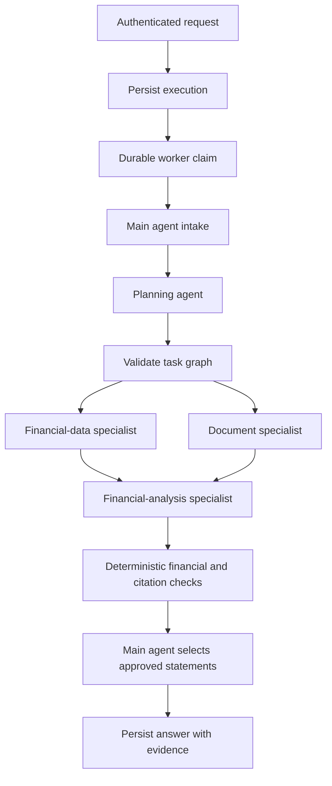

# Financial Assistant

A read-only financial comparison service with a supervisor, planner, structured-data specialist, document specialist, and financial analyst. LangGraph coordinates the workflow; application code owns authorization, tools, financial calculations, and execution limits.

The included ledger and management notes are synthetic. This release supports comparisons between exactly two quarterly reporting periods. It is not a trading or payment system.

## Request flow



## Requirements

- Python 3.12 or 3.13 and uv 0.13.5.
- Docker Desktop with Linux containers for the reproducible database environment.
- An OpenAI API key with access to the configured models and API billing credit. ChatGPT Plus does not include API credit.
- An OIDC provider for production. Local development can explicitly enable the restricted synthetic identity.

## Local setup

Run `uv sync --locked`, then `uv run python scripts/init_local.py` to generate a development `.env` with distinct credentials. Set `FIN_OPENAI_API_KEY` locally. Alternatively, configure `.env.example` manually using different URL-safe random database passwords of at least 24 characters. Never commit `.env`.

Install and verify dependencies:

```powershell
uv sync --locked
uv run finance-preflight
```

Start the database, build the image, apply migrations, provision roles, and seed synthetic examples:

```powershell
docker compose --env-file .env -f deploy/compose.yaml up -d db
docker compose --env-file .env -f deploy/compose.yaml build
docker compose --env-file .env -f deploy/compose.yaml run --rm migrate
docker compose --env-file .env -f deploy/compose.yaml run --rm seed
docker compose --env-file .env -f deploy/compose.yaml up -d api worker
```

The seed command makes two small embedding requests. It is restricted to development. Ingestion does not use execution budgets; the seed is bounded by its fixed synthetic dataset. General ingestion must run as an authorized administrative job with a separate spend policy.

The API listens at `http://localhost:8000`, its interactive documentation at `/docs`, and PostgreSQL at `localhost:55432`. Compose is a development deployment and deliberately enables no public ingress.

For local Python commands, the `.env` database URLs must use `localhost:55432`. Compose supplies its own internal `db:5432` URLs. Do not interchange them.

## Example request

```powershell
$headers = @{ Authorization = "Bearer $env:FIN_DEV_TOKEN" }
$body = @{
  question = 'Why did profit decline, and what do management notes say?'
  entity = 'acme'
  periods = @('2026-Q1', '2026-Q2')
} | ConvertTo-Json
$job = Invoke-RestMethod http://localhost:8000/questions -Method Post -Headers $headers -ContentType application/json -Body $body
Invoke-RestMethod "http://localhost:8000/executions/$($job.execution_id)" -Headers $headers
```

Set the shell token from your secret manager or local configuration first; it is not automatically imported from `.env` into PowerShell.

Expected synthetic arithmetic: revenue increases from PKR 1,000,000 to 1,100,000; expenses increase from 700,000 to 900,000; profit falls from 300,000 to 200,000, or 33.33%. Retrieved notes describe logistics disruption and a marketing campaign as management's explanation. The model's exact wording can vary.

`POST /questions` returns HTTP 202. Poll the owned execution URL. `POST /executions/{id}/cancel` requests cancellation. Requests for `beta` under the development `acme` identity return HTTP 403. Unknown or unowned executions return HTTP 404.

## Models and cost

| Role | Default model |
|---|---|
| Main, financial-data, document | `gpt-6-luna` |
| Planner, financial analysis | `gpt-6.1-sol` |
| Document embeddings | `text-embedding-3-small`, 1536 dimensions |

Every identifier is configurable. Preflight checks account visibility without silently substituting another model. Live tests must verify endpoint capabilities as well. Model access can change independently of the code.

Per-execution budgets reserve conservative estimated input/output tokens and cost before each model attempt. Reservations persist through worker recovery and are not refunded after failures. They may reject a request before actual spend reaches the configured limit. Usage and pricing-based costs are estimates, not billing invoices. Provider-side usage limits remain advisable.

The OpenAI SDK retries are disabled; the adapter permits one retry only for transient errors, reserving budget for each attempt. Financial tools do not accept model-supplied tenant IDs, entity scope, SQL, or code.

## Verification

```powershell
uv run ruff check src tests scripts evals benchmarks
uv run ruff format --check src tests scripts evals benchmarks
uv run mypy src
uv run pytest -m 'not postgres and not live'
uv run python -m evals.runner
uv run python scripts/verify_postgres.py
```

`verify_postgres.py` creates/uses only the dedicated `finance_verify` database. It applies migrations, provisions roles, and exercises real vector queries, source row-level security, and checkpoint recovery. It requires local owner credentials. Routine tests use deterministic model fixtures; they do not establish LLM quality.

To run a bounded live evaluation, stop the worker, ensure there are no queued jobs, seed the demo, then run:

```powershell
uv run python -m evals.live --allow-paid --budget-usd 1.00
```

Reports go to ignored `artifacts/`. Live evaluations are never run automatically in normal CI. Acceptance criteria are committed in `evals/configs/acceptance.json`.

## Operational boundaries

- API and worker are separate processes. Jobs are persisted before acceptance. Workers use database leases and recover incomplete graphs after lease expiry.
- Cancellation interrupts active work when the worker polls; already-sent provider requests may still be billed.
- A failed document task permits a numeric partial result. Missing or incompatible financial periods produce insufficient evidence. Permission or budget violations stop execution.
- The financial summary is rendered from deterministic calculations. Model explanations must cite retrieved evidence and pass numeric checks. Semantic source support still requires evaluation and human review.
- Production source credentials are separate from ingestion and migration credentials. Source tables enforce tenant/entity row-level security. Application/checkpoint tables are trusted-backend storage; users never receive direct database access.
- The development identity is fixed to `demo/acme`; it cannot access `other/beta`.
- Use a TLS reverse proxy, ingress rate limits, OIDC claims mapping, managed secrets, backups, retention, and deployment-specific monitoring before a production release.

See [architecture](docs/architecture.md), [threat model](docs/threat-model.md), [evaluation methodology](docs/evaluation-methodology.md), and [operations](docs/runbooks/operations.md). Actual verification evidence and outstanding limits are recorded in `docs/verification.md`.
